# Akademi Koçum

Yerel yapay zekâ ile çalışan, öğrencinin notlarını öğrenme akışına dönüştüren
Flutter tabanlı ders ve soru asistanı. Uygulama; nottan özet, kaynak gösteren
sohbet, otomatik test, kodla puanlama, eksik konulara göre öneri, ezber kartları
ve haftalık çalışma planını tek bir akışta birleştirir.

> **Proje durumu:** Eğitim/demonstrasyon amaçlı yerel geliştirme projesi.
> Üretime almadan önce HTTPS, gerçek Android release imzası, rate limiting,
> gözlemlenebilirlik ve yedekleme politikaları ayrıca yapılandırılmalıdır.

## İçindekiler

- [Öne çıkan özellikler](#özellikler)
- [Teknoloji yığını](#teknoloji-yığını)
- [Mimari](#mimari)
- [Gereksinimler](#gereksinimler)
- [Hızlı başlangıç](#hızlı-başlangıç)
- [Flutter uygulamasını çalıştırma](#flutter-uygulamasını-çalıştırma)
- [API](#api)
- [Geliştirici komutları](#geliştirici-komutları)
- [Proje yapısı](#proje-yapısı)
- [Dokümantasyon](#dokümantasyon)
- [Güvenlik ve sınırlamalar](#güvenlik-ve-sınırlamalar)
- [Sorun giderme](#sorun-giderme)

## Teknoloji yığını

| Katman | Teknoloji | Sorumluluk |
|---|---|---|
| Mobil/web istemci | Flutter, Dart, Provider | Ekranlar, oturum, form doğrulama, REST istemcisi |
| API orkestrasyonu | n8n | Webhook'lar, iş akışları, doğrulama ve hata yönetimi |
| Yapay zekâ | Ollama | Özet, sohbet, test, öneri ve görselden metin üretimi |
| Kalıcı veri | Microsoft SQL Server 2022 | Kullanıcı, ders, not, test, sonuç ve kart verileri |
| Yerel çalışma | Docker Compose | n8n, SQL Server ve Ollama servislerinin yönetimi |

## Özellikler

| | Özellik | Nerede |
|---|---|---|
| ✅ | E-posta + şifre ile kayıt/giriş (scrypt hash, JWT) | `01-register`, `02-login` |
| ✅ | Ders bazlı soru-cevap, sohbet geçmişi SQL Server'da | `03-ask` |
| ✅ | Not yapıştırma / TXT / **PDF** yükleme, Türkçe özet | `04-summarize`, `09-extract-pdf` |
| ✅ | Nottan çoktan seçmeli test (JSON şeması + doğrulama + 2 yeniden deneme) | `05-generate-quiz` |
| ✅ | Puanlama **kodla**, yanlış konulara göre kişisel öneri | `06-evaluate` |
| ✅ | **Yanlışları tekrar çöz** (anında geri bildirimli pratik modu) | Flutter `PracticeScreen` |
| ✅ | **Eksik konudan yeni test** (konuya odaklı soru üretimi, `focusTopic`) | `05-generate-quiz` |
| ✅ | Ders bazlı başarı istatistikleri (SQL view + `GROUP BY`) | `07-data` → `stats` |
| ✅ | Zayıf konulara göre 7 günlük çalışma programı | `08-study-plan` |
| ✅ | RAG: notlar `NoteChunks`'a bölünür, soruya ilgili parçalar bağlam olarak verilir (FTS varsa Full-Text, yoksa anahtar kelime) | `04-summarize`, `03-ask` |
| ✅ | Hata yakalayıcı workflow (Error Trigger) + her düğümde hata dalı | `00-error-handler` |
| ⭐ | **Defter fotoğrafından not:** el yazısı/tahta fotoğrafını yerel görsel model (`gemma4:12b`) metne çevirir | `11-extract-image` |
| ⭐ | **Kaynak gösteren cevaplar:** asistan cevabın hangi not bölümünden geldiğini `[1]` ile belirtir, dokununca not açılır | `03-ask` |
| ⭐ | **Uyarlanabilir zorluk:** son 3 testte %80+ → zor, %50 altı → kolay; elle de seçilebilir | `05-generate-quiz` |
| ⭐ | **Ezber kartları + aralıklı tekrar (SM-2):** nottan kart üretimi, "Bugün tekrar" oturumu, bilinmeyen kart sık sorulur | `10-flashcards`, `07-data` |
| ⭐ | **Haftalık e-posta raporu (Brevo SMTP):** her pazartesi 09:00 zamanlanmış + uygulamadan isteğe bağlı | `12-weekly-report` |
| ⭐ | **Model karşılaştırma raporu:** 3 model, aynı prompt/şema, JSON geçerlilik ve hız ölçümü | [docs/model-karsilastirma.md](docs/model-karsilastirma.md) |

## API uç noktaları

Hepsi `POST`, JSON; `register`/`login` dışındakiler `Authorization: Bearer <jwt>` ister.

| Uç nokta | Girdi | Çıktı |
|---|---|---|
| `/webhook/register` | `{ name, email, password }` | `201 { token, user }` · `409` e-posta kayıtlı |
| `/webhook/login` | `{ email, password }` | `200 { token, user }` · `401` |
| `/webhook/ask` | `{ userId, courseId?, question }` | `{ answer, sources[{index, noteId, title, excerpt, cited}], messageId, usedNotes }` |
| `/webhook/summarize` | `{ userId, courseId, title, content }` | `201 { noteId, summary }` |
| `/webhook/generate-quiz` | `{ userId, noteId, questionCount (5-10), difficulty? (otomatik/kolay/orta/zor), focusTopic? }` | `201 { quizId, difficulty, difficultyReason, questions[] }` — **cevap ve açıklama yok** |
| `/webhook/evaluate` | `{ userId, quizId, answers: [{ questionIndex, selected }] }` | `{ score, total, results[], recommendation, recommendationDetail }` |
| `/webhook/data` | `{ action, params }` — `dashboard`, `stats`, `courses.*`, `notes.*`, `chat.*`, `results.get`, `cards.due`, `cards.review {cardId, grade 0-5}` | `{ data }` |
| `/webhook/study-plan` | `{ hoursPerDay }` | `{ overview, days[7], tips }` |
| `/webhook/extract-pdf` | multipart `file` | `{ text, pages }` |
| `/webhook/extract-image` | multipart `file` (JPG/PNG/WEBP) | `{ text, characters, model }` |
| `/webhook/flashcards` | `{ noteId, count (5-20) }` | `201 { created, dueCards, cards[] }` |
| `/webhook/weekly-report` | `{ dryRun? }` | `dryRun: true` → `{ subject, html }` önizleme · aksi halde e-posta gönderilir |

Hatalar her zaman `{ "error": "Türkçe mesaj" }` biçimindedir: `400` doğrulama, `401/403` yetki, `404` kayıt yok, `500` veritabanı, `502` Ollama.

## Mimari

Flutter istemcisi REST JSON ile n8n webhook'larına bağlanır. n8n, uygulama verisini SQL Server'da; yapay zekâ isteklerini yerel Ollama'da yürütür. n8n'in kendi verisi SQLite volume'unda tutulur.

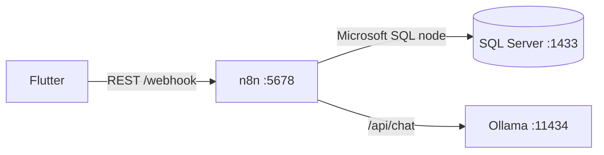

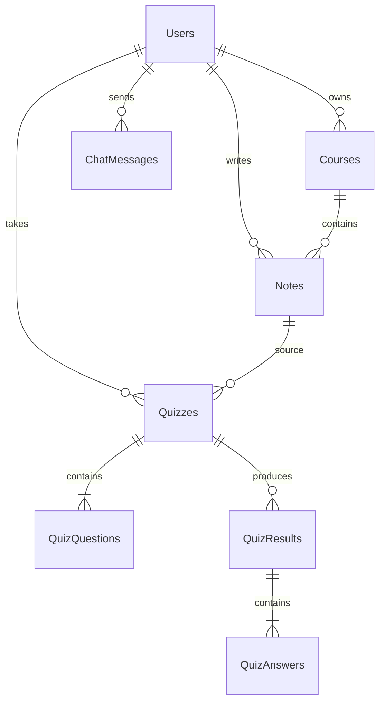

Detaylı mimari için [docs/architecture.md](docs/architecture.md) dosyasına bakın.

## Gereksinimler

- Windows 10/11, Docker Desktop ve WSL2
- Flutter SDK (bu makinede `C:\flutter`)
- Android Studio veya Android SDK/Emulator
- Docker Compose v2
- En az 8 GB RAM; Ollama modeli için tercihen GPU

SQL Server imajı x86_64 içindir. Apple Silicon cihazlarda Docker Desktop Rosetta emülasyonu gerekir.

## Hızlı başlangıç

### 1. Backend'i hazırlayın

```powershell
cd backend
Copy-Item .env.example .env
notepad .env
docker compose --env-file .env up -d
docker compose --env-file .env ps
```

`.env` içindeki en az `MSSQL_SA_PASSWORD`, `APP_DB_PASSWORD`,
`N8N_ENCRYPTION_KEY` ve `JWT_SECRET` değerlerini değiştirin. Tamamen Docker
üzerinde çalışmak için `COMPOSE_PROFILES=mssql,ollama` bırakılabilir. Host'ta
kurulu SQL Server/Ollama kullanılacaksa [Host SQL modu](#host-sql-modu)
ayarlarını uygulayın.

İlk açılışta `db-init` veritabanı şemasını, `ollama-pull` ise seçilen modeli
hazırlar. n8n hazır olduğunda API `http://localhost:5678` üzerinden erişilir.

### 2. Flutter'ı çalıştırın

Proje köküne dönüp cihazı kontrol edin:

```powershell
cd ..
C:\flutter\bin\flutter.bat pub get
C:\flutter\bin\flutter.bat devices
C:\flutter\bin\flutter.bat run
```

Android emülatöründe varsayılan API adresi `http://10.0.2.2:5678` olur.
Gerçek cihaz için bilgisayarın LAN adresini verin:

```powershell
C:\flutter\bin\flutter.bat run --dart-define=API_BASE_URL=http://BILGISAYAR_LAN_IP:5678
```

Adres daha sonra uygulamadaki **Sunucu ayarları** ekranından da değiştirilebilir.

### 3. İlk kullanım

1. Kayıt olun ve giriş yapın.
2. Bir ders oluşturun.
3. En az 50 karakterlik not metni veya TXT/PDF yükleyin.
4. Özet çıkarın, ardından aynı nottan test üretin.
5. Testi tamamlayıp sonuç ekranındaki önerileri inceleyin.

## Backend kurulumu

```powershell
cd backend
Copy-Item .env.example .env
notepad .env
docker compose --env-file .env up -d
docker compose --env-file .env ps
```

`.env` içinde `MSSQL_SA_PASSWORD`, `APP_DB_PASSWORD`, `N8N_ENCRYPTION_KEY` ve `JWT_SECRET` değerlerini değiştirin. `COMPOSE_PROFILES=mssql,ollama` tam Docker modudur. Host SQL/Ollama kullanacaksanız profilleri boş bırakıp `APP_DB_HOST=host.docker.internal` ve uygun `OLLAMA_BASE_URL` ayarlayın.

### Brevo SMTP

Brevo SMTP API key'ini parola olarak kullanın; MCP anahtarını SMTP parolası olarak kullanmayın:

```dotenv
BREVO_SMTP_HOST=smtp-relay.brevo.com
BREVO_SMTP_PORT=587
BREVO_SMTP_USER=b60130001@smtp-brevo.com
BREVO_SMTP_PASSWORD=Brevo_SMTP_API_KEY
BREVO_SMTP_FROM_EMAIL=do-not-reply@example.com
BREVO_SMTP_FROM_NAME=Akademi Koçum
```

`n8n-import` bu değerlerle `Brevo SMTP` credential'ını oluşturur; `12-weekly-report` workflow'u bu credential'ı kullanır. `BREVO_SMTP_PASSWORD` değerini sohbet, Git veya ekran görüntüsünde paylaşmayın.

Haftalık rapor iki şekilde çalışır:
- **Uygulamadan:** İstatistikler ekranındaki ✉ butonu raporu yalnızca giriş yapan kullanıcıya gönderir. API'de `{"dryRun": true}` ile e-posta göndermeden HTML önizlemesi alınır (örnek: [docs/ornek-haftalik-rapor.html](docs/ornek-haftalik-rapor.html)).
- **Zamanlanmış:** Her pazartesi 09:00'da son iki haftada aktif olan tüm kullanıcılara. Yanlışlıkla toplu e-posta gitmesin diye varsayılan olarak **kapalıdır**; açmak için `.env` → `WEEKLY_REPORT_ENABLED=true`.

Şifre sıfırlama workflow'u bulunmadığından credential kurulumu tek başına şifre sıfırlama akışını aktive etmez.

İlk Docker çalıştırmasında `ollama-pull` modeli indirir. Varsayılan model `qwen2.5:7b`'dir; düşük RAM için:

```dotenv
OLLAMA_MODEL=qwen2.5:3b
```

Workflow'lar [backend/n8n/workflows](backend/n8n/workflows) altından n8n'e import edilip aktifleştirilir. `n8n-import` servisi bunu otomatik yapar.

### Model değiştirme

1. `.env` içinde `OLLAMA_MODEL` değerini değiştirin (ör. `qwen2.5:3b`, `qwen2.5:7b`, `gemma4:12b`).
2. `docker compose up -d` — `ollama-pull` yeni modeli indirir, n8n yeni ayarla yeniden başlar.

Bilgisayarda kurulu Ollama kullanılıyorsa (`OLLAMA_BASE_URL=http://host.docker.internal:11434`) modeli elle indirin: `ollama pull qwen2.5:7b`. Model büyüdükçe yanıt kalitesi artar ama süre uzar; 8 GB GPU'da `qwen2.5:7b` iyi bir dengedir (özet ~10-30 sn, test ~20-40 sn). Ölçümler: [docs/model-karsilastirma.md](docs/model-karsilastirma.md) — yeniden ölçmek için `node backend/tests/benchmark-models.mjs`.

Fotoğraftan not için ayrı bir **görsel model** kullanılır: `OLLAMA_VISION_MODEL=gemma4:12b` (`ollama pull gemma4:12b`). Görsel destekli ve düşünme modu kapatılabilen bir model seçin: `qwen3-vl:8b` düşünme modunu kapatamadığı için çıktı üretmeden token sınırına takılıyor.

### Workflow'ları kaynaktan üretme

Workflow JSON'ları elle düzenlenmez; okunabilir kaynaktan üretilir:

```bash
node backend/n8n/build/build.mjs     # backend/n8n/workflows/*.json
node backend/n8n/build/to-sdk.mjs    # backend/n8n/sdk/*.js (n8n Cloud / MCP ile yüklemek için)
docker compose -f backend/docker-compose.yml run --rm n8n-import
docker compose -f backend/docker-compose.yml restart n8n
```

Code düğümleri `build/*.mjs` içinde gerçek JS fonksiyonları olarak yazılır; ortak yardımcılar (`build/common.mjs`) her düğüme yalnızca kullandığı kadarıyla eklenir.

Host SQL modu:

```powershell
cd backend
powershell -ExecutionPolicy Bypass -File scripts/init-local.ps1
```

## Flutter uygulamasını çalıştırma

Android emülatör:

```powershell
C:\flutter\bin\flutter.bat devices
C:\flutter\bin\flutter.bat run
```

Android emülatörde API adresi otomatik olarak `http://10.0.2.2:5678` olur. Gerçek cihazda ve aynı LAN'da:

```powershell
C:\flutter\bin\flutter.bat run --dart-define=API_BASE_URL=http://BILGISAYAR_LAN_IP:5678
```

Alternatif olarak uygulamadaki **Sunucu ayarları** ekranından adresi değiştirebilirsiniz.

## Canlı demo

1. Backend'i başlatın ve `http://localhost:5678` ile n8n'in hazır olduğunu kontrol edin.
2. Flutter'da kayıt olun ve giriş yapın.
3. Bir ders oluşturun.
4. En az 50 karakterlik not metni veya TXT/PDF yükleyin.
5. Özeti alın; not SQL Server'a kaydedilir.
6. Aynı nottan 5 soruluk test üretin.
7. En az bir soruyu yanlış cevaplayıp testi bitirin.
8. Sonuç ekranında puan, açıklamalar ve kişisel çalışma önerisini gösterin.

API smoke test:

```bash
bash backend/tests/api-test.sh http://localhost:5678
```

Senaryonun çekim metni: [docs/demo-senaryosu.md](docs/demo-senaryosu.md) · Prompt tasarımı: [docs/prompts.md](docs/prompts.md)

## Ekran görüntüleri

| | | |
|---|---|---|
| 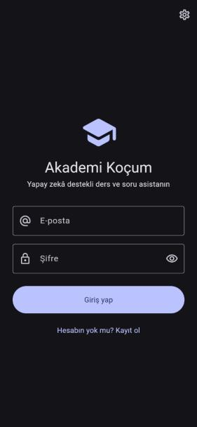 | 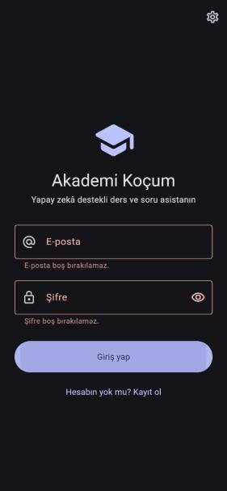 | 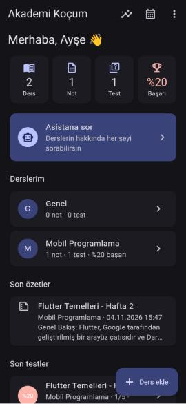 |
| 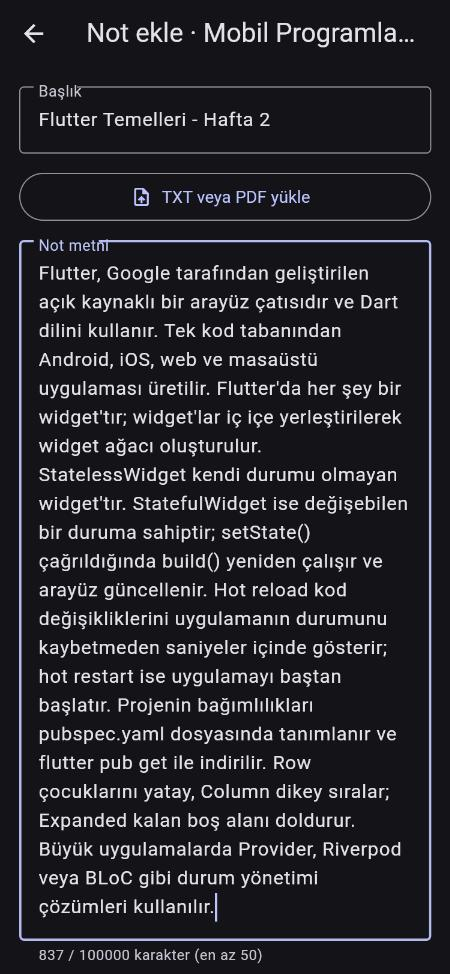 | 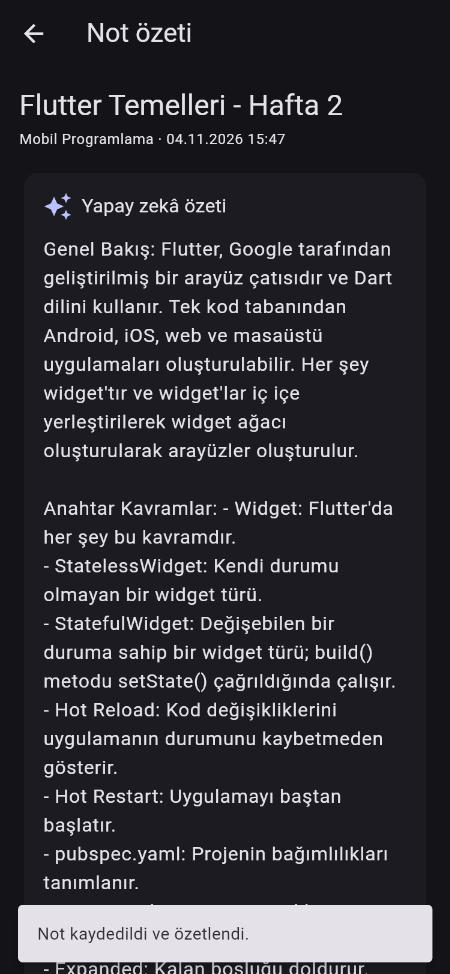 | 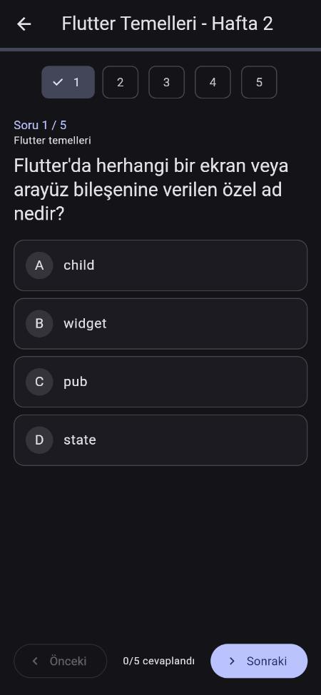 |
| 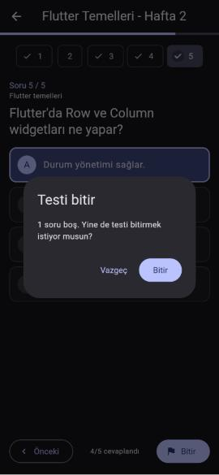 | 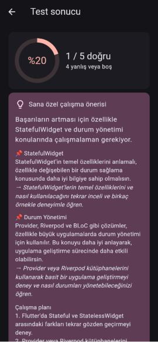 | 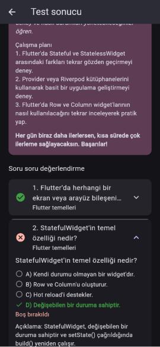 |
| 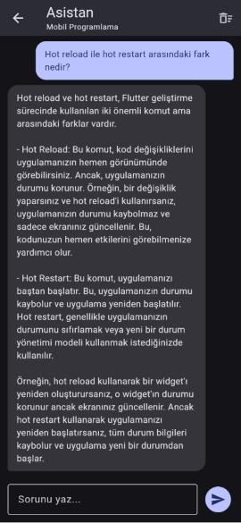 | 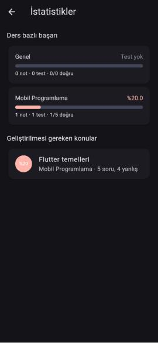 | 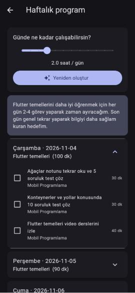 |

## Proje yapısı

```
lib/
  config/        API adresi (emülatör / LAN / --dart-define)
  core/          ApiClient (JWT, zaman aşımı, Türkçe hata), ViewState (yükleniyor/başarılı/hata)
  models/        fromJson/toJson modelleri
  services/      Auth, Course, Note, Chat, Quiz, Flashcard, Insights servisleri
  state/         Session (oturum, token saklama)
  screens/       Giriş, ana sayfa, ders, not (TXT/PDF/fotoğraf), sohbet (kaynaklı), test (zorluk),
                 sonuç, pratik, ezber kartı tekrarı, istatistik (+ e-posta raporu), plan
backend/
  docker-compose.yml, .env.example
  sql/init.sql               Şema, view'lar, fn_DecodePayload, uygulama kullanıcısı
  scripts/                   db-init, n8n-import, host modu yardımcıları
  n8n/build/                 Workflow kaynak kodu (üretici)
  n8n/workflows/             Import edilen workflow JSON'ları
  tests/api-test.sh          Uçtan uca API testi (tüm uç noktalar + hata durumları)
  tests/benchmark-models.mjs Model karşılaştırması (docs/model-karsilastirma.md üretir)
docs/                        Mimari + ER diyagramı, prompt'lar, demo senaryosu, ekran görüntüleri
```

## Güvenlik notları

- Şifreler `scrypt` (tuzlu, yavaş KDF — bcrypt eşdeğeri) ile saklanır; düz metin hiçbir yerde tutulmaz. Giriş/kayıt workflow'ları yürütme geçmişine veri yazmaz.
- SQL injection: kullanıcı verisi sorgu metnine hiç eklenmez. n8n tek bir `$1` parametresi (`@p1`) gönderir; değer UTF-16 JSON'un base64'üdür ve SQL tarafında `dbo.fn_DecodePayload` + `OPENJSON` ile okunur.
- n8n, SQL Server'a `sa` ile değil, yalnızca okuma/yazma/EXECUTE yetkili `study_app` kullanıcısıyla bağlanır.
- Her korumalı uç nokta JWT'yi doğrular; gövdedeki `userId` token'daki kullanıcıyla eşleşmezse `403` döner.

## Sorun giderme

- Docker Desktop açılırken `initializing Secrets Engine ... engine.sock ... The file cannot be accessed by the system` hatası: bilgisayar beklenmedik kapandığında eski soket dosyası kalır. Docker Desktop'ı kapatın, `%LOCALAPPDATA%\docker-secrets-engine` klasörünün adını değiştirin (ör. `docker-secrets-engine.stale`) ve Docker'ı yeniden açın; klasör yeniden oluşturulur.
- Model yanıtında `谋`, `艧` gibi Çince karakterler: Qwen modellerinin Türkçe harfleri GBK okunuşuyla yazdığı bilinen bir durum. Workflow'lar bunu otomatik düzeltir (`fixTurkish`); başka bir modelde görülürse aynı tabloya eklenebilir.
- Test oluşturma `502` ("Model 3 denemede geçerli bir test üretemedi"): model nadiren şemaya uymaz; tekrar deneyin veya daha büyük bir model seçin.
- `401`: JWT secret'ın backend'de tanımlı olduğunu ve istemcinin doğru API adresini kullandığını kontrol edin.
- `404`: n8n workflow'larının import/active durumunu kontrol edin.
- Ollama hatası: `docker compose logs ollama ollama-pull` ve `docker compose exec ollama ollama list`.
- SQL hatası: `docker compose logs sqlserver db-init n8n`.
- Android emülatör `offline` kalıyor veya açılmıyorsa eski emulator/qemu süreçlerini kapatıp ADB'yi yeniden başlatın:

```powershell
$sdk = "C:\Users\Mahmu\AppData\Local\Android\sdk"
& "$sdk\platform-tools\adb.exe" kill-server
Get-Process emulator,qemu-system-x86_64 -ErrorAction SilentlyContinue | Stop-Process -Force
& "$sdk\platform-tools\adb.exe" start-server
& "$sdk\emulator\emulator.exe" -avd Medium_Phone_API_37.0 -no-snapshot -no-boot-anim -gpu swiftshader_indirect
```

`emulator -list-avds` ile AVD adını öğrenin. Sanallaştırma/Hyper-V kapalıysa veya grafik sürücüsü sorunluysa Android Studio'dan AVD Graphics değerini `Software` yapın.

## Geliştirici komutları

```powershell
C:\flutter\bin\flutter.bat analyze
C:\flutter\bin\flutter.bat test
C:\flutter\bin\flutter.bat build apk --debug
```

Android release imzası demo için debug anahtarını kullanır. Mağaza yayını öncesinde gerçek keystore ve benzersiz application ID tanımlanmalıdır.

Workflow kaynaklarını JSON/SDK çıktısına dönüştürmek için:

```powershell
node backend/n8n/build/build.mjs
node backend/n8n/build/to-sdk.mjs
```

API smoke test'i için:

```bash
bash backend/tests/api-test.sh http://localhost:5678
```

Model karşılaştırması için:

```powershell
node backend/tests/benchmark-models.mjs
```

## Dokümantasyon

- [Sistem mimarisi](docs/architecture.md): servisler, veri akışı, ER diyagramı
- [Demo senaryosu](docs/demo-senaryosu.md): uçtan uca gösterim akışı
- [Prompt tasarımı](docs/prompts.md): model girdileri ve JSON sözleşmeleri
- [Model karşılaştırması](docs/model-karsilastirma.md): kalite ve süre ölçümleri
- [Örnek haftalık rapor](docs/ornek-haftalik-rapor.html): e-posta önizlemesi

## Güvenlik ve sınırlamalar

- `backend/.env` repoya alınmaz; gerçek sırları `.env.example` içine yazmayın.
- Şifreler n8n Code node'unda Node.js `crypto.scrypt` ile tuzlanarak hash'lenir.
- Korunan uç noktalar JWT doğrular ve gövdedeki `userId` ile token kullanıcısını
  karşılaştırır.
- SQL sorguları kullanıcı verisini doğrudan metne birleştirmez; parametreli
  payload yaklaşımı kullanılır.
- Varsayılan Docker kurulumu HTTP ve yerel ağ içindir. İnternet'e açmadan önce
  reverse proxy/HTTPS, erişim kontrolü, rate limiting ve secret yönetimi ekleyin.
- Haftalık toplu e-posta varsayılan olarak kapalıdır; yalnızca açıkça
  `WEEKLY_REPORT_ENABLED=true` yapılırsa zamanlayıcı çalışır.
