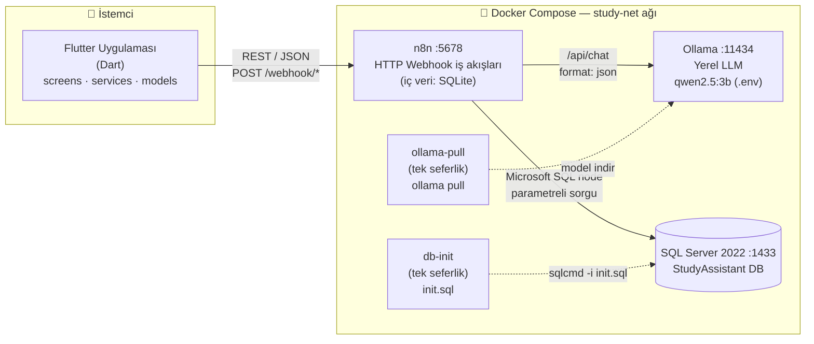
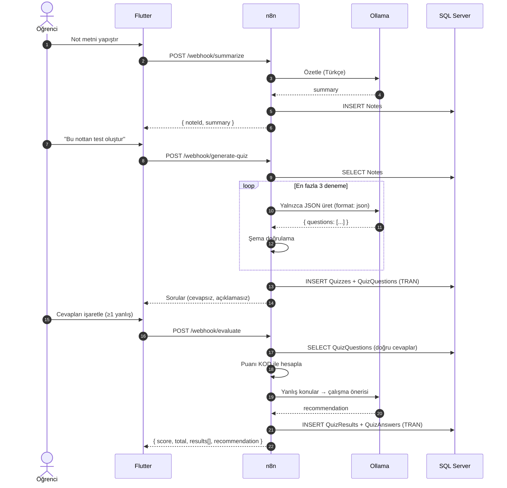
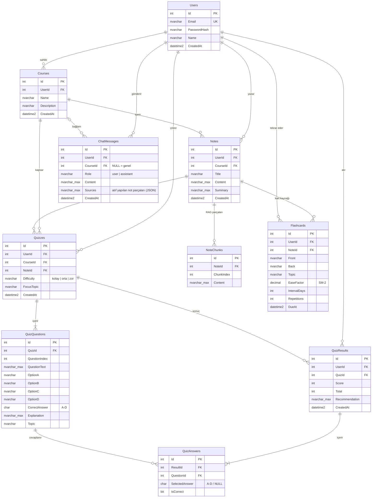

# Akademi Koçum — Sistem Mimarisi

Yapay zekâ destekli akıllı ders ve soru asistanı. Tüm servisler yerelde, Docker Compose ile çalışır.

## 1. Sistem mimarisi



**Uç noktalar (n8n webhook'ları):**

| Uç nokta | Görev | Okur | Yazar |
|---|---|---|---|
| `POST /webhook/register` | Kayıt | Users | Users |
| `POST /webhook/login` | Giriş | Users | — |
| `POST /webhook/ask` | Soru-cevap | ChatMessages (son N) | ChatMessages |
| `POST /webhook/summarize` | Not özeti | — | Notes |
| `POST /webhook/generate-quiz` | Test üretimi | Notes | Quizzes, QuizQuestions (transaction) |
| `POST /webhook/evaluate` | Değerlendirme + öneri | QuizQuestions | QuizResults, QuizAnswers (transaction) |
| `POST /webhook/data` | Dersler, notlar, geçmiş, istatistik, kart tekrarı (SM-2) | Tümü (view'lar) | Courses, ChatMessages, Flashcards |
| `POST /webhook/study-plan` | 7 günlük program | vw_CourseStats, vw_TopicPerformance | — |
| `POST /webhook/extract-pdf` | PDF → metin | — | — |
| `POST /webhook/extract-image` | Defter fotoğrafı → metin (görsel model) | — | — |
| `POST /webhook/flashcards` | Nottan ezber kartı | Notes, Flashcards | Flashcards |
| `POST /webhook/weekly-report` + **Schedule** (Pzt 09:00) | Haftalık e-posta raporu (Brevo SMTP) | Users, QuizResults, view'lar | — |

**Çalışma modları** (`backend/.env` → `COMPOSE_PROFILES`):

| Mod | `COMPOSE_PROFILES` | SQL Server | Ollama | Şema kurulumu |
|---|---|---|---|---|
| Host (geliştirme makinesi) | boş | Bilgisayardaki instance → `host.docker.internal,1433` | Bilgisayardaki Ollama → `http://host.docker.internal:11434` | `scripts/init-local.ps1` |
| Tam Docker (teslim / demo) | `mssql,ollama` | `sqlserver:1433` konteyneri | `http://ollama:11434` konteyneri | `db-init` servisi |

Her iki modda n8n Docker'da çalışır ve aynı `init.sql` kullanılır.

**Adresler:** Android emülatör → `http://10.0.2.2:5678`, gerçek cihaz → `http://<bilgisayarın-LAN-IP'si>:5678`, n8n → Ollama `http://ollama:11434`, n8n → SQL Server `sqlserver:1433`.

## 2. Canlı demo akışı (sequence)



## 3. ER diyagramı



### Silme (cascade) stratejisi

SQL Server, aynı tabloya birden fazla cascade yolu olmasına izin vermez. Bu yüzden her tabloda **tek** bir cascade yolu var, diğer FK'ler `NO ACTION`:

```
Users ─CASCADE→ Courses ─CASCADE→ Notes ─CASCADE→ Quizzes ─CASCADE→ QuizQuestions
                        └CASCADE→ ChatMessages        └──CASCADE→ QuizResults ─CASCADE→ QuizAnswers
```

## 4. Varsayımlar

1. **`CorrectAnswer` / `SelectedAnswer` harf olarak (`A`–`D`) saklanır.** Ollama `correct_answer`'ı seçenek metni olarak döndürür; n8n bunu doğrulama sırasında harfe çevirir. İstemci de `selected` alanında harf gönderir.
2. **`ChatMessages.CourseId` boş olabilir** — ana sayfadaki "asistana sor" ders seçmeden de çalışsın diye.
3. **Şifre hash'i:** n8n Code node'unda harici `bcrypt` paketi yok; Node'un yerleşik `crypto.scrypt` fonksiyonu (tuzlu, yavaş KDF — bcrypt eşdeğeri) kullanılır. Biçim: `scrypt$<salt-hex>$<hash-hex>`.
4. **n8n uygulama verisine ayrı bir SQL login (`APP_DB_USER`) ile bağlanır**, `sa` ile değil. Bu kullanıcının yalnızca okuma/yazma yetkisi vardır.
